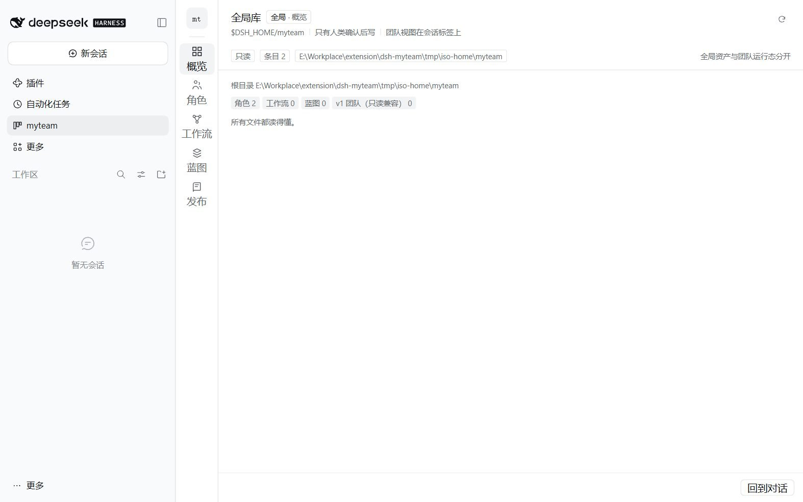
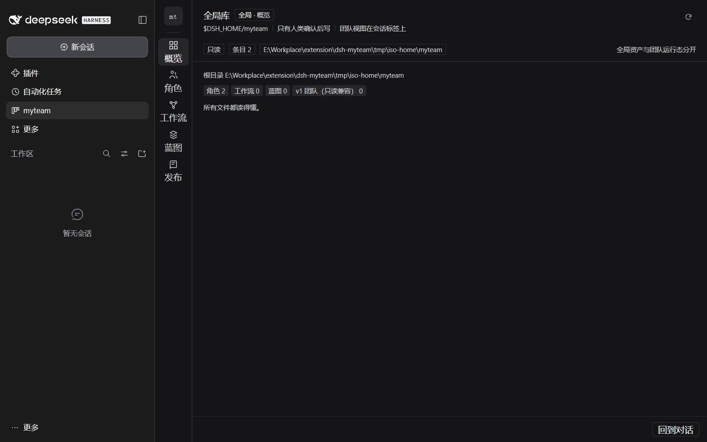
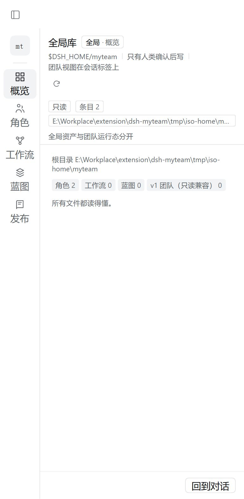

# 隔离验收记录（2.0.0）

> 按本机技能 `dsh-plugin-isolated-test`（`~/.dsh/skills/` 下）跑的一轮**机器可判**验收：
> 独立 `DSH_HOME` + 独立 profile + 独立端口，全程不碰正在用的桌面端。
> 人眼项（深色 / 窄宽 / 真实点击）不在本文范围，见 [24-人工验收步骤](24-人工验收步骤.md)。

## 环境（三件分开）

| 维度 | 值 |
|---|---|
| `DSH_HOME` | `tmp/iso-home`（新建；`profiles/` `storages/` `.credentials.yaml` 都在里面） |
| profile | `iso-myteam` —— 从出货模板复制：`dsh --profile iso-myteam --from-default-profile web --dump-config` |
| 插件 | `dsh plugin --profile iso-myteam add link:E:/Workplace/extension/dsh-myteam/plugin` → `2.0.0` |
| 端口 | `3099`（`--host 127.0.0.1 --no-open`） |
| 工作区副本 | `tmp/live-ws`（拷自仓库 `.dsh-myteam`，删掉别人的 `state/writer.lock`） |

隔离证据：`globalLibrary.root` 返回 `tmp/iso-home/myteam`（不是 `~/.dsh/myteam`）；
验收前后用户真实 `~/.dsh/myteam` 快照完全一致（391 → 391 字符）。

## 结果：**ISO_VERIFY_OK — 46/46**

| 分组 | 条数 | 判据（摘要） |
|---|---|---|
| 准入与路由 | 5 | 未认证 401 `MT_UNAUTHENTICATED`；未知方法 404 `MT_UNKNOWN_METHOD`；非 POST 405；缺 `sessionId` 400；**没有活会话时明确拒绝**且不回落到进程 cwd |
| 全局库读面 | 2 | `globalLibrary` / `globalAudit` 200，且根指向隔离 home |
| 客户端资产 | 5 | 页面 200 有挂载点；插件 bundle 被宿主发出且与仓库 `client.js` 同源；含标签「团队视图」；不再用「项目」当 scope；`design.css` 作用域已是 `[data-myteam]` 且含深色段 |
| 读面 | 12 | `status` `overview` `board` `definitions` `migration` `runs` `knowledge` `memory` `audit` `settings` + `team` / `task` 详情全部真数据 |
| **对账** | 3 | 看板计数 = 概览 `totals`（1 vs 1）；审计条数 = 账本事件数（15 vs 15）；概览团队 ⊂ 账本 `team.created` |
| 写面 | 8 | 记忆：缺 `confirm` → `INVALID_PAYLOAD`、写入后读面立刻可见、软删留痕；解散：预览发令牌、不确认不改、篡改令牌 `CONFIRMATION_TARGET_CHANGED`；任务：缺验收标准被拒、正常建卡后看板立刻可见 |
| 清除与隔离 | 3 | 按端口停掉自己的实例；用户真实 home 未被改动；写面只落在副本（副本账本 24849B → 26484B） |

## 过程中修正的两条**断言**（不是产品缺陷，记下来免得下次误判）

1. **审计对账按“行数”比 → 15 vs 43**：事件账本一行可能是**一个批次**（`{batchId, events:[…]}`）。
   改成数事件后 15 = 15。
2. **团队对账拿 `state/teams.json` → 找不到「甲队」**：那是 v1 兼容索引
   （里面是旧团队名），`state/teams/default/ledger.jsonl` 也只剩 rules 版本事件。
   v2 的真源是 `events/project.jsonl` 里的 `team.created`。

## 未覆盖（不要当成验过）

- **人眼**：深色主题、窄宽度、真实点击后的观感 —— 浏览器控制不可用，只能人来点。
- **真实模型回合**：隔离 home 的 `.credentials.yaml` 是空的，agent 建队/派活没跑；
  面板读写本身不需要模型。
- **桌面端**：按约定完全不碰；`~/.dsh/profiles/desktop` 里本来就没有这个插件。

## 复跑

```powershell
node tmp/verify-iso.mjs    # 起隔离实例 → 46 项判据 → 按端口停自己 → 删工作区副本
```

脚本放在 `tmp/`（本机临时产物，不随包发布）；配方与判据在技能
`dsh-plugin-isolated-test` 里，换机器照它重写即可。

## 视觉（机器可量部分，2026-11-22 补）

做法：隔离实例（3099）+ 本地**只注入 cookie** 的预览代理（3098 → 3099，
同时把 `Host`/`Origin` 改写成宿主的源，否则会被信任栅栏判成 `403 MT_UNTRUSTED_HOST`），
再用设计工作台的 `look_design` / `check_design` 按 1280×800、414×844、浅/深量。

已截到并核对的屏：**左栏「myteam」全局库**（概览：条目 2、角色 2 / 工作流 0 / 蓝图 0、
v1 团队 0、根目录指向隔离 home）。

| 浅色 1280×800 | 深色 1280×800 | 窄宽 414×844 |
|---|---|---|
|  |  |  |

量出来的三处问题（都已修，`check_design` 深色 0 问题、浅色只剩宿主自己的 2 条）：

| # | 现象 | 根因 | 修法 |
|---|---|---|---|
| 1 | 深色下导航轨 4 个 tab 对比度 **3.54:1**（#CFD3D6 配 #6B6B6B） | 宿主给原生 `button` 一套灰底，`.ri` 只声明了 hover/选中底色 | `.ri` 显式 `background: transparent; border: 0; padding: 0` |
| 2 | 414px 宽时页头摘要被裁 41px、状态条路径裁 107px、备注裁 274px | `.hd .sub` / `.bar` 子项 `white-space: nowrap` 且不换行 | 加 `@media (max-width: 760px)`：换行 + 省略号 + 备注整行 |
| 3 | 面板底部「回到对话」出现两次（`.layer` 标签 + 按钮），按钮被压成整宽 | 客户端多渲染了一个设计稿里没有的 `.layer` | 改成单一 footer（`.ft`）里的按钮，右上对齐 |

> 浅色下剩下的 2 条对比度是**宿主左栏自己的**（类名 `GAkraW_*`：`工作区` / `暂无会话`，3.55:1），
> 不在本插件样式范围内，改不了也不该在这里改。

**没验到的**：会话「团队视图」九栏的视觉。自动化点不进会话（隔离实例里 `session.create` 造出的
空会话不进左栏列表），这一屏仍需要人点一次：在隔离实例里点「选择工作区」选
`tmp/shot-ws` 后进入会话，再点「团队视图」。