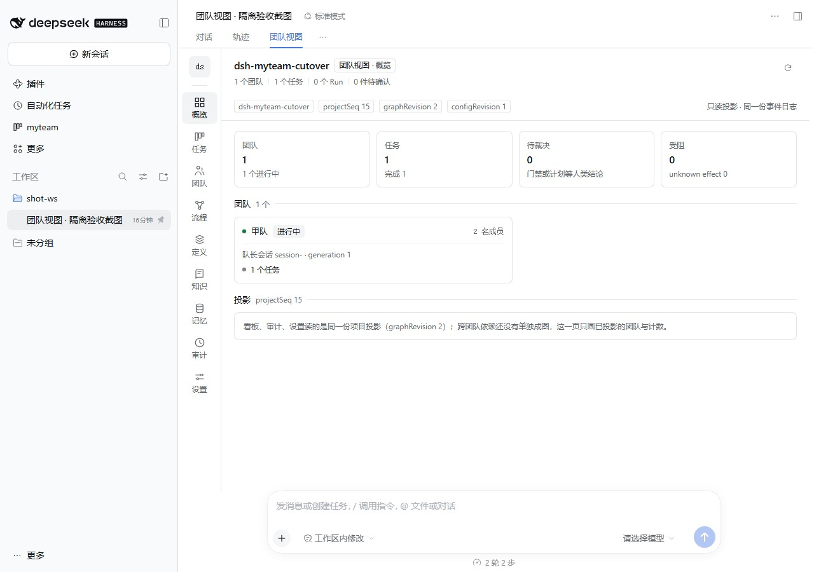
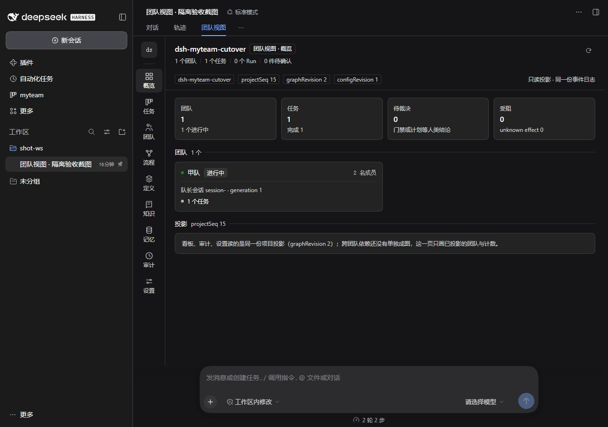
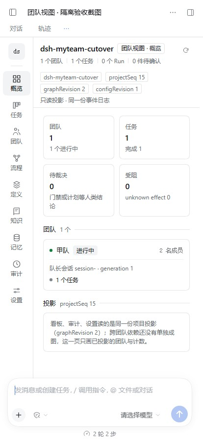
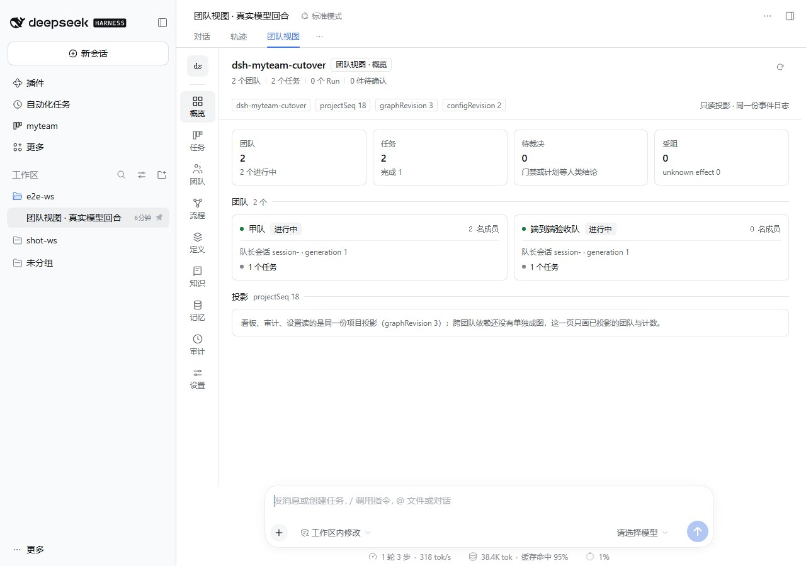
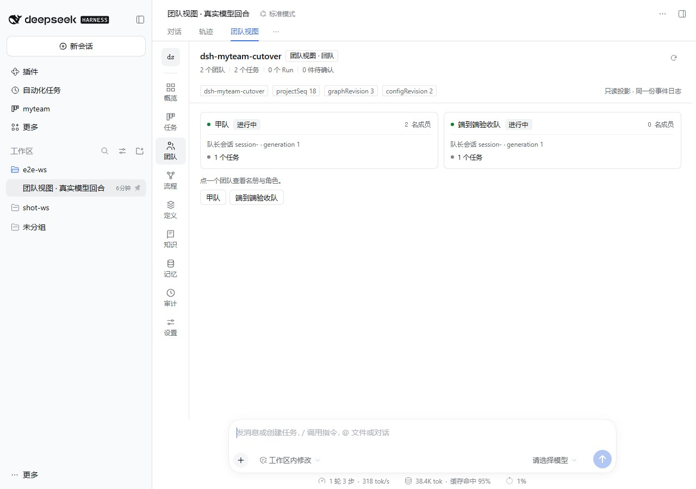

# 隔离验收记录（2.0.0）

> 按本机技能 `dsh-plugin-isolated-test`（`~/.dsh/skills/` 下）跑的一轮**机器可判**验收：
> 独立 `DSH_HOME` + 独立 profile + 独立端口，全程不碰正在用的桌面端。
> 深色 / 窄宽 / 真实点击原本要人眼，2026-11-23 起用 CDP 真点补齐（见「会话「团队视图」视觉」一节）；
> 人工复看步骤仍在 [24-人工验收步骤](24-人工验收步骤.md)。

## 环境（三件分开）

| 维度 | 值 |
|---|---|
| `DSH_HOME` | `tmp/iso-home`（新建；`profiles/` `storages/` `.credentials.yaml` 都在里面） |
| profile | `iso-myteam` —— 从出货模板复制：`dsh --profile iso-myteam --from-default-profile web --dump-config` |
| 插件 | `dsh plugin --profile iso-myteam add link:E:/Workplace/extension/dsh-myteam/plugin` → `2.0.0` |
| 端口 | `3099`（`--host 127.0.0.1 --no-open`） |
| 工作区副本 | `tmp/live-ws`（拷自仓库 `.dsh-myteam`，删掉别人的 `state/writer.lock`） |

隔离证据：`globalLibrary.root` 返回 `tmp/iso-home/myteam`（不是 `~/.dsh/myteam`）；
验收前后用户真实 `~/.dsh/myteam` 快照完全一致（391 → 391 字符）。

## 结果：**ISO_VERIFY_OK — 46/46**

| 分组 | 条数 | 判据（摘要） |
|---|---|---|
| 准入与路由 | 5 | 未认证 401 `MT_UNAUTHENTICATED`；未知方法 404 `MT_UNKNOWN_METHOD`；非 POST 405；缺 `sessionId` 400；**没有活会话时明确拒绝**且不回落到进程 cwd |
| 全局库读面 | 2 | `globalLibrary` / `globalAudit` 200，且根指向隔离 home |
| 客户端资产 | 5 | 页面 200 有挂载点；插件 bundle 被宿主发出且与仓库 `client.js` 同源；含标签「团队视图」；不再用「项目」当 scope；`design.css` 作用域已是 `[data-myteam]` 且含深色段 |
| 读面 | 12 | `status` `overview` `board` `definitions` `migration` `runs` `knowledge` `memory` `audit` `settings` + `team` / `task` 详情全部真数据 |
| **对账** | 3 | 看板计数 = 概览 `totals`（1 vs 1）；审计条数 = 账本事件数（15 vs 15）；概览团队 ⊂ 账本 `team.created` |
| 写面 | 8 | 记忆：缺 `confirm` → `INVALID_PAYLOAD`、写入后读面立刻可见、软删留痕；解散：预览发令牌、不确认不改、篡改令牌 `CONFIRMATION_TARGET_CHANGED`；任务：缺验收标准被拒、正常建卡后看板立刻可见 |
| 清除与隔离 | 3 | 按端口停掉自己的实例；用户真实 home 未被改动；写面只落在副本（副本账本 24849B → 26484B） |

## 过程中修正的两条**断言**（不是产品缺陷，记下来免得下次误判）

1. **审计对账按“行数”比 → 15 vs 43**：事件账本一行可能是**一个批次**（`{batchId, events:[…]}`）。
   改成数事件后 15 = 15。
2. **团队对账拿 `state/teams.json` → 找不到「甲队」**：那是 v1 兼容索引
   （里面是旧团队名），`state/teams/default/ledger.jsonl` 也只剩 rules 版本事件。
   v2 的真源是 `events/project.jsonl` 里的 `team.created`。

## 未覆盖（不要当成验过）

- **人眼**：深色主题、窄宽度、真实点击后的观感 —— 浏览器控制不可用，只能人来点。
- **真实模型回合**：隔离 home 的 `.credentials.yaml` 是空的，agent 建队/派活没跑；
  面板读写本身不需要模型。
- **桌面端**：按约定完全不碰；`~/.dsh/profiles/desktop` 里本来就没有这个插件。

## 复跑

```powershell
node tmp/verify-iso.mjs    # 起隔离实例 → 46 项判据 → 按端口停自己 → 删工作区副本
```

脚本放在 `tmp/`（本机临时产物，不随包发布）；配方与判据在技能
`dsh-plugin-isolated-test` 里，换机器照它重写即可。

## 视觉（机器可量部分，2026-11-22 补）

做法：隔离实例（3099）+ 本地**只注入 cookie** 的预览代理（3098 → 3099，
同时把 `Host`/`Origin` 改写成宿主的源，否则会被信任栅栏判成 `403 MT_UNTRUSTED_HOST`），
再用设计工作台的 `look_design` / `check_design` 按 1280×800、414×844、浅/深量。

已截到并核对的屏：**左栏「myteam」全局库**（概览：条目 2、角色 2 / 工作流 0 / 蓝图 0、
v1 团队 0、根目录指向隔离 home）。

| 浅色 1280×800 | 深色 1280×800 | 窄宽 414×844 |
|---|---|---|
|  |  |  |

量出来的三处问题（都已修，`check_design` 深色 0 问题、浅色只剩宿主自己的 2 条）：

| # | 现象 | 根因 | 修法 |
|---|---|---|---|
| 1 | 深色下导航轨 4 个 tab 对比度 **3.54:1**（#CFD3D6 配 #6B6B6B） | 宿主给原生 `button` 一套灰底，`.ri` 只声明了 hover/选中底色 | `.ri` 显式 `background: transparent; border: 0; padding: 0` |
| 2 | 414px 宽时页头摘要被裁 41px、状态条路径裁 107px、备注裁 274px | `.hd .sub` / `.bar` 子项 `white-space: nowrap` 且不换行 | 加 `@media (max-width: 760px)`：换行 + 省略号 + 备注整行 |
| 3 | 面板底部「回到对话」出现两次（`.layer` 标签 + 按钮），按钮被压成整宽 | 客户端多渲染了一个设计稿里没有的 `.layer` | 改成单一 footer（`.ft`）里的按钮，右上对齐 |

> 浅色下剩下的 2 条对比度是**宿主左栏自己的**（类名 `GAkraW_*`：`工作区` / `暂无会话`，3.55:1），
> 不在本插件样式范围内，改不了也不该在这里改。

**这一屏原来没验到**：自动化点不进会话（隔离实例里 `session.create` 造出的空会话不进左栏列表）。
2026-11-23 用 CDP 真点补上了，见下一节。

## 会话「团队视图」视觉（2026-11-23 用 CDP 真点补上）

做法：隔离实例（同上，端口 3099）+ 本机 Chrome headless
（`--remote-debugging-port=9222`）+ 一段场景脚本，**真点**左栏会话行 → 点会话级「团队视图」标签 →
等面板渲染 → 截图；浅色 / 深色用 `Emulation.setEmulatedMedia` 切，窄宽用
`Emulation.setDeviceMetricsOverride`（414×900）。直接开宿主打印的 `?token=` 地址，由宿主自己发 cookie。

| 浅色 1280×900 | 深色 1280×900 | 窄宽 414×900 |
|---|---|---|
|  |  |  |

图里读的是工作区副本 `tmp/shot-ws` 的真实投影：项目 `dsh-myteam-cutover`、`projectSeq 15`、
`graphRevision 2`、1 个团队（甲队，2 名成员）、1 个任务（已完成）、0 个 Run。

### 量出来四处问题（都已修）

| # | 现象 | 根因 | 修法 |
|---|---|---|---|
| 1 | 会话视图里字全变大：骨架 13px→**16px**、导航轨 12px→**16px**，标题与输入框一起被撑 | 适配层把 `--dsh-font` 设成 `inherit`（CSS-wide 关键字），设计稿那些 `font: 400 13px/1.5 var(--dsh-font)` **整条简写在计算值阶段失效**，字号回落到继承值 | `panel.ts` 适配层给具体字族（宿主没有字体变量，只有颜色变量） |
| 2 | 改用类名后骨架仍然没有字号（`.wt` 16px） | 设计稿选择器都写成 `[data-slot="main"] x`，服务时换成 `[data-myteam] x`，**是后代选择器**；骨架把 `data-myteam` 和 `.wt` 放在同一个节点上，`[data-myteam] .wt` 选不到它自己 | 客户端改两层根：作用域节点 `[data-myteam]` > `.wt` |
| 3 | 414px 下四联计数卡挤成 85px 一列，「门禁或计划等人类结论」折四行；团队卡「甲队」竖排 | 计数卡用**行内样式**写死 `repeat(4,minmax(0,1fr))`，媒体查询改不动 | 换成 `.grid.c4` 类；`@media (max-width:760px)` 里 c4 退两列、c2/c3 退单列，`.rc-h` 允许换行 |
| 4 | 看板 8 个状态列折成两排时被拉伸成上下各半屏（设计稿只画了 5 列） | `.board` 是 `flex:1 1 auto` 的网格，默认 `align-content: normal` 会把两行撑满 | `.board { align-content: start }`，两排各自贴合内容 |

深色下没有出现对比度问题，也没有元素越界（逐元素探测 `overflowX` 命中 0）。

### 九栏逐栏点过（同一会话里真点）

| 栏 | 渲染 | 读到的内容 |
|---|---|---|
| 概览 | ✅ | 计数 1 团队 / 1 任务 / 0 待裁决 / 0 受阻；投影 `projectSeq 15` |
| 任务 | ✅ | 8 个状态列，1 张卡（`Web 闭环验证`，已完成） |
| 团队 | ✅ | 甲队：进行中、2 名成员、队长会话 `session-…`、1 个任务 |
| 流程 / 知识 / 记忆 | ✅ | 空态（这个项目还没有这些条目），文案说明为什么空 |
| 定义 | ✅ | 角色 / 工作流 / 蓝图定义副本列表 |
| 审计 | ✅ | 15 条事件（`#15 task.completed` … `#1 project.initialized`） |
| 设置 | ✅ | 只读配置项 |

全程 0 条 JS 异常、0 处横向溢出。

### 对比度（同一页面量的，按 WCAG）

| 取样 | 浅色 | 深色 |
|---|---|---|
| 状态条 chip / 页头摘要（12px 次要文字） | 5.8:1 | 12.11:1 |
| 团队名 / 层级标题（13px 主文字） | 18.9:1 | 15.03:1 |
| 导航轨标签（12px，含选中态） | 16.97:1 | 14.13:1 |

### 滚动与遮挡

会话区是宿主的滚动容器（`.an3WzG_scrollBody`，824 高 / 内容 1248）。审计栏 15 条滚到底后，
最后一条底边 720px，输入框顶边 772px —— **没有被输入框遮住**。整块视图（含页头）跟着宿主滚，
与宿主内置的「轨迹」视图一致，所以没有另做内层滚动条。

### 截图现场的说明

隔离 home 没有 API key，宿主的回合会报 `MISSING_CREDENTIAL`（截图里会话消息区的「处理失败」是它）。
面板读写不走模型，与这些无关。会话标题是用宿主自己的 `session/rename` 改的，不是手改索引。

## 真实模型回合（2026-11-23 补，模型到面板整条打通）

环境：隔离 home 里配了 `magpie` 路由（用户加的模型），会话用**团队模式**预设（`myteam-captain`）。

做法：`session/create { workspaceId }` 造会话（带 `workspaceId` 才会被登记进工作区列表 → 左栏能点）
→ `session/prompt` 给它一段「建队 / 建任务 / 读看板」的指令 → 轮询投影直到空闲 → 直接读账本对账。

| 观测点 | 结果 |
|---|---|
| 模型 | `magpie` / `workbuddy/deepseek-v4.1-flash`，1 轮 2 步，`llmMs 15379`，`ttftMs 6610` |
| 工具调用 | `myteam_create_team` → `myteam_create_task` → `myteam_read_board` |
| 账本（`tmp/e2e-ws/.dsh-myteam/events/project.jsonl`） | 事件 43 → 50；新增 `team.created`（**端到端验收队**）、`task.created`（**真实模型回合验证**） |
| 面板读面（`/__myteam/overview`） | `teams: 甲队 / 端到端验收队`，`totals 2`，`projectSeq 18`，`graphRevision 3` |
| 审计 | `task.created` 的 actor 是 `captain: session-3566dbe5…` —— 写的人确实是那个会话 |

| 概览（真回合刚跑完） | 团队栏 |
|---|---|
|  |  |

底部「1 轮 3 步 · 318 tok/s · 38.4K tok · 缓存命中 95%」是宿主自己的回合统计，不是画的。

## 打包安装才暴露的缺陷（已修，发版前必须验）

- **现象**：把 `npm pack` 出的 tgz 装进一个新 profile（= 真正的 npm 安装）后，
  `GET /__myteam/assets/design.css` → **500**，`MT_ASSET_UNAVAILABLE … node_modules\design-v2\tokens.css`，
  面板没有任何样式。
- **根因**：`resolveDesignDir()` 原来只按「包根/../design-v2」推。`link:` 安装时包根是 `<repo>/plugin`，
  `../design-v2` 正好是仓库的设计稿；**复制安装**时包根是 `node_modules/dsh-plugin-myteam`，
  那个路径指向 `node_modules/design-v2` —— 不存在。而且 `package.json` 的 `files` 里也没有
  `design-v2`，包里根本没带样式表。隔离实例一直是 `link:` 安装，所以这条一直没暴露。
- **修法**：`scripts/build-lib.mjs` 在构建时把仓库 `design-v2` 拷进包内（`copyDesignAssets`）；
  `files` 加 `design-v2`；`resolveDesignDir()` 先看仓库根（开发/link 改了就生效）、再回落包内副本；
  t31 加一条守门用例（目录可读 + `files` 带 design-v2 + 构建里有拷贝步骤）。
- **验证**：tgz 装进 `iso-pack` profile 后再起实例 → `design.css` **200 / 51914 B**，
  作用域 `[data-myteam]`、`--dsh-font` 具体字族、`.grid.c4` 全在；上面两张图就是**打包安装**这一份代码截的。